# Testlauf Runde 1: MVP 2, fertige Seiten, Ganzseiten, Paarung

Bilder aus dem automatischen Ende-zu-Ende-Lauf (Demo-Reise, synthetische Fotos). Erzeugt mit `tools/galerie.py`.

## Start

Ordner öffnen und Analyse starten. Alles bleibt lokal.

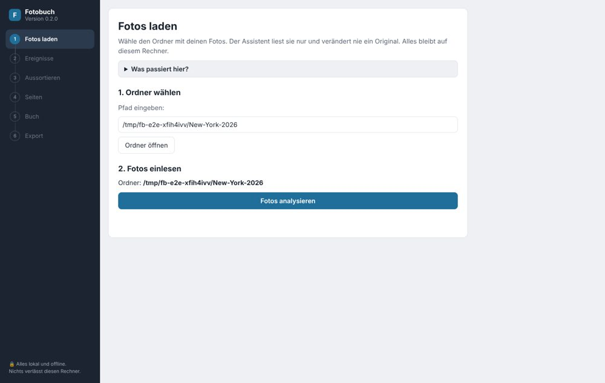

## Ereignisse

Ereignisse aus der Aufnahmezeit mit Namen, Zeitraum und Orten. Fotos ohne Aufnahmezeit stehen am Schluss.

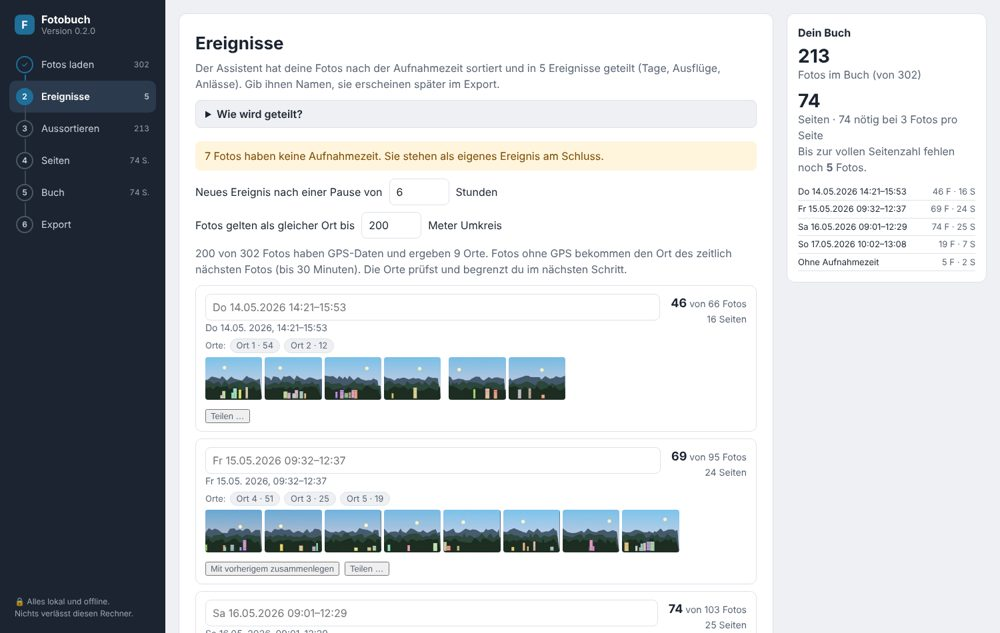

## Ereignis teilen

Ein Klick auf ein Foto lässt dort ein neues Ereignis beginnen. Zusammenlegen und Zurücksetzen gehören dazu.

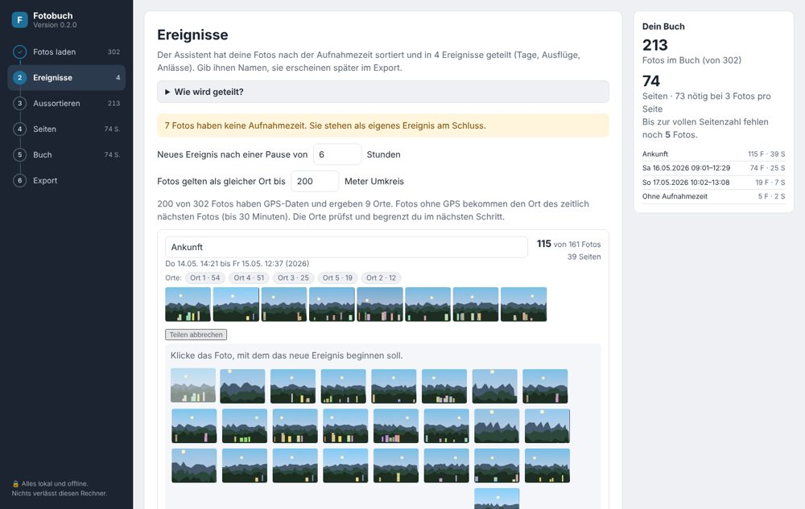

## Aussortieren

Serien und Duplikate mit Vorschlag und Begründung.

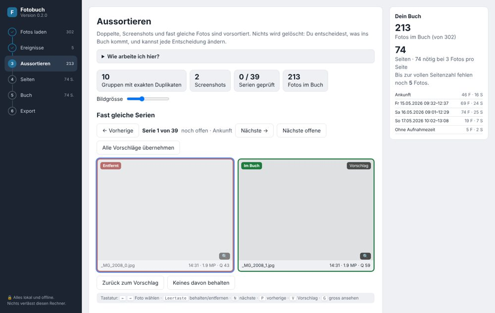

## Orte

GPS-Orte mit Begrenzung pro Ort.

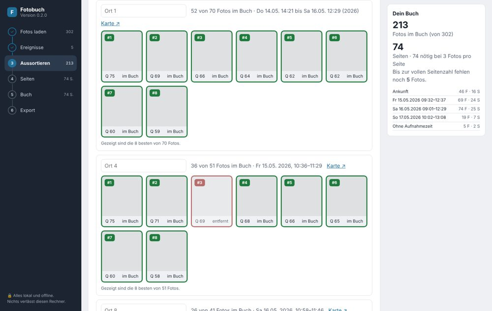

## Seiten

Seitenzähler mit Anbieter-Profil, Auffüllen und Kürzen.

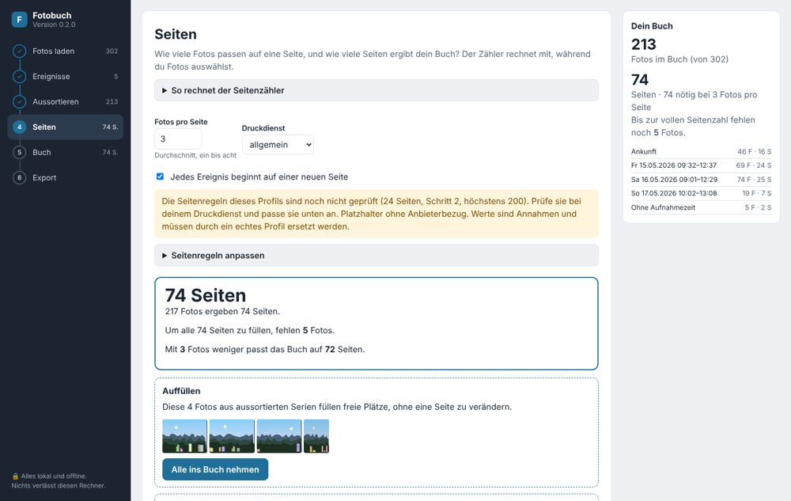

## Foto im Detail

Begründung, ob und warum ein Foto im Buch ist; Foto als ganze Seite setzen.

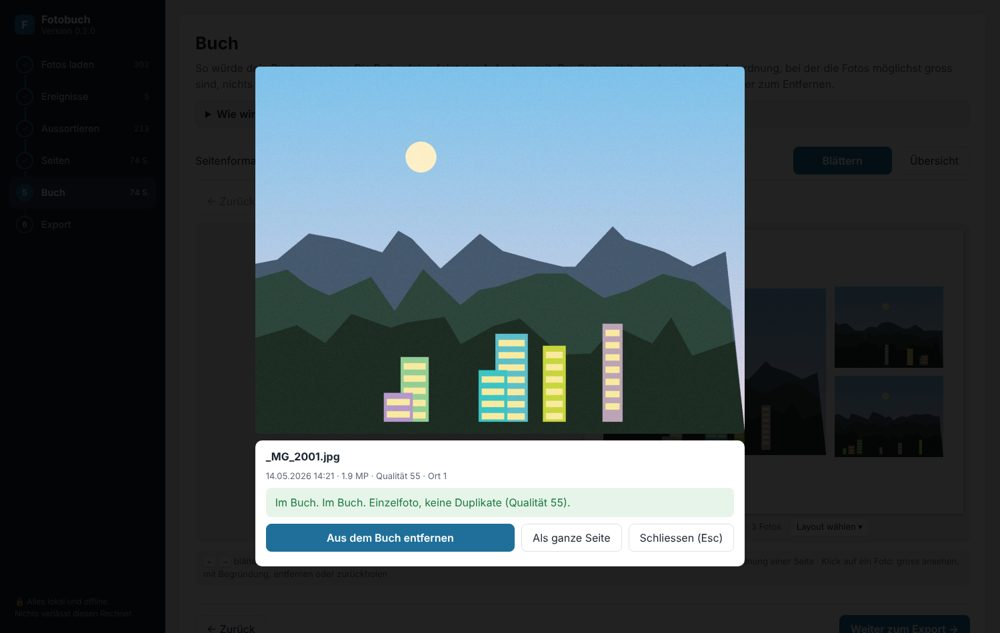

## Panorama auf eigener Seite

Sehr breite Fotos bekommen automatisch eine ganze Seite.

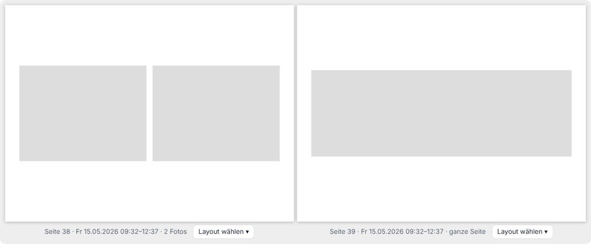

## Layout-Vorlagen

Pro Seite lassen sich Anordnungen wie Vorlagen wählen.

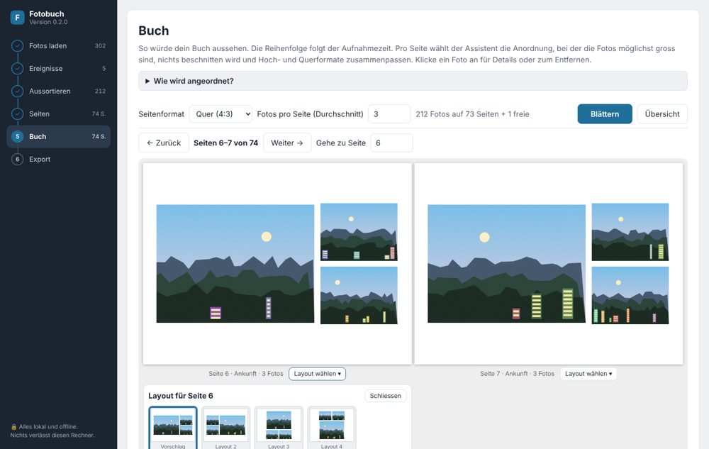

## Buch, Übersicht

Alle Seiten auf einen Blick.

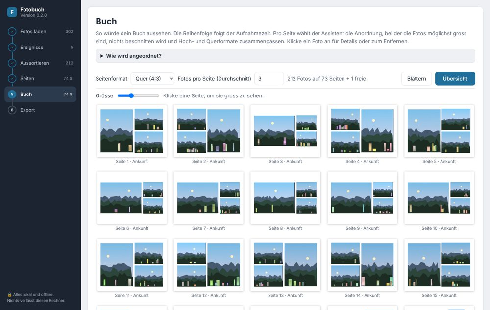

## Buch, Doppelseite

Blättern durch das Buch mit automatisch gewählten Layouts.

## Export mit fertigen Seiten

Jede Seite als JPEG (300 dpi) und alle Seiten als eine PDF.

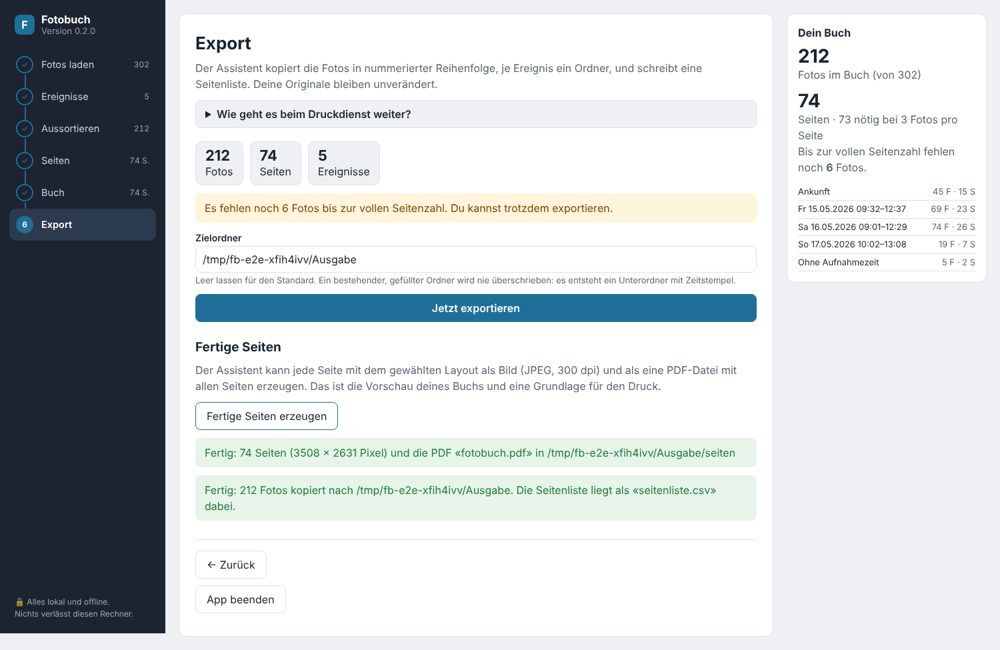

## Fertige Seite 1

Gerendert aus dem Export.

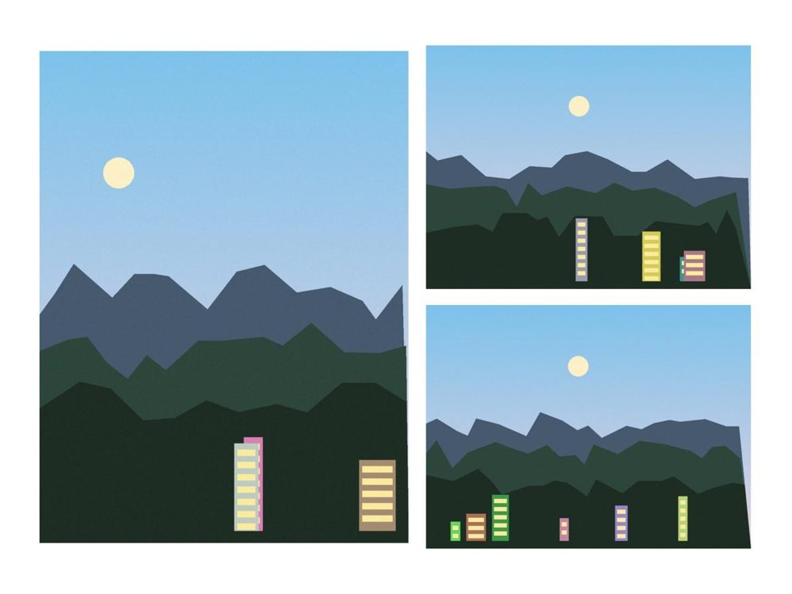

## Fertige Seite 2

Gerenderte Seite aus dem Export, verkleinert.

