# Testlauf Runde 2: Fotos verschieben, Panorama über die Doppelseite

Bilder aus dem automatischen Ende-zu-Ende-Lauf (Demo-Reise, synthetische Fotos). Erzeugt mit `tools/galerie.py`.

## Start

Ordner öffnen und Analyse starten. Alles bleibt lokal.

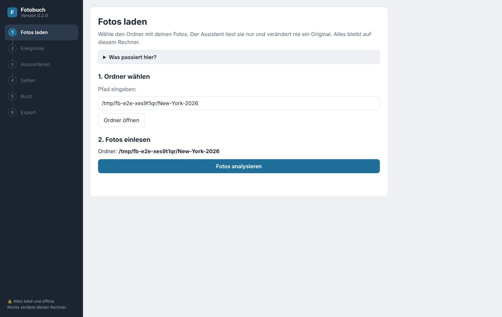

## Ereignisse

Ereignisse aus der Aufnahmezeit mit Namen, Zeitraum und Orten. Fotos ohne Aufnahmezeit stehen am Schluss.

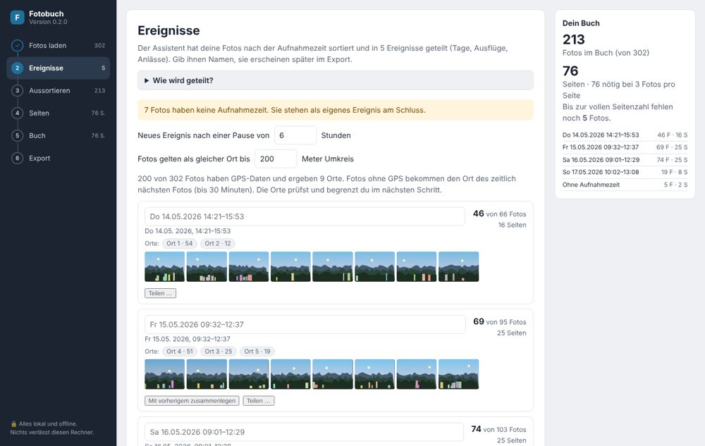

## Ereignis teilen

Ein Klick auf ein Foto lässt dort ein neues Ereignis beginnen. Zusammenlegen und Zurücksetzen gehören dazu.

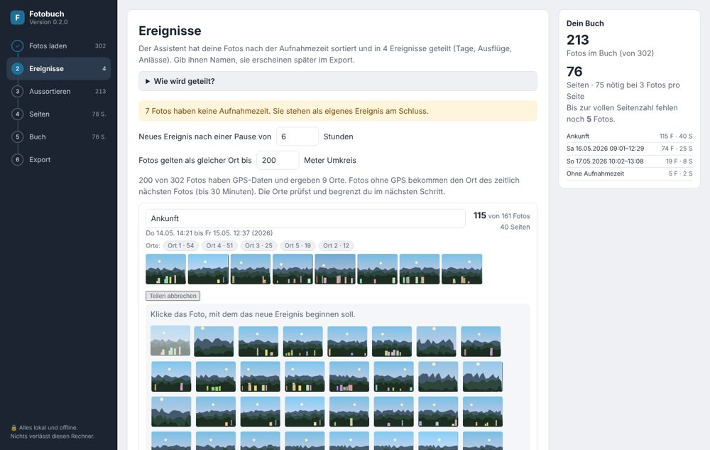

## Aussortieren

Serien und Duplikate mit Vorschlag und Begründung.

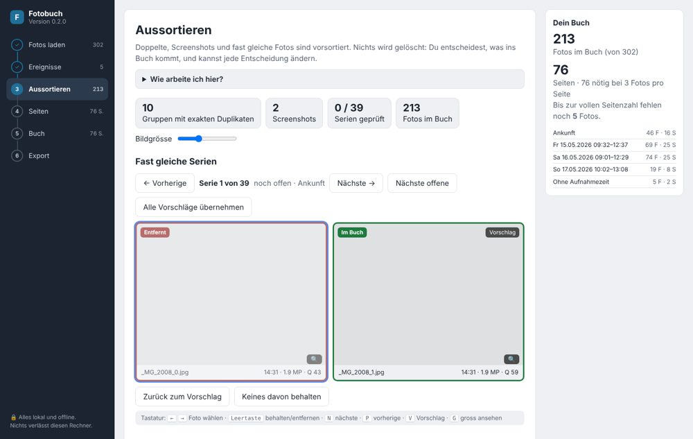

## Orte

GPS-Orte mit Begrenzung pro Ort.

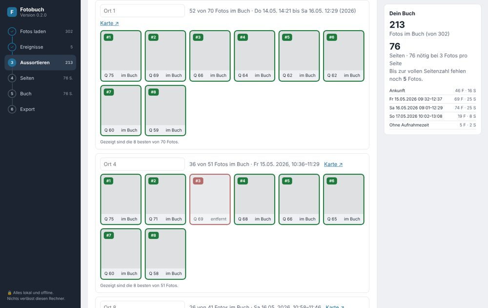

## Seiten

Seitenzähler mit Anbieter-Profil, Auffüllen und Kürzen.

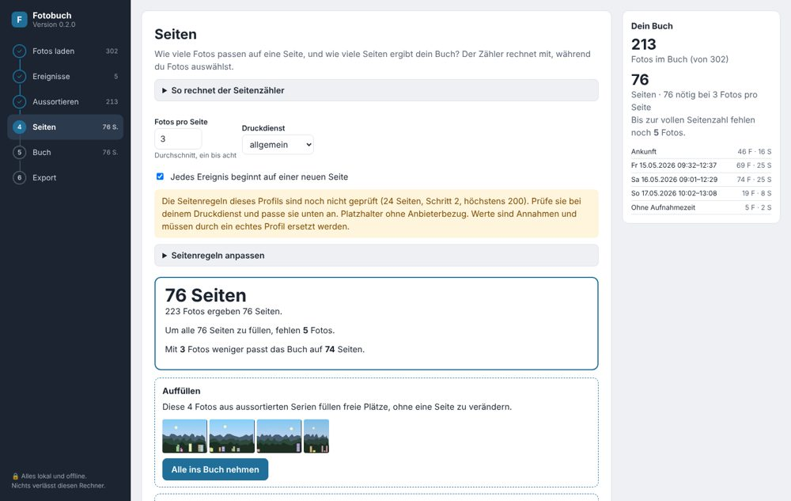

## Foto im Detail

Begründung, ob und warum ein Foto im Buch ist; Foto als ganze Seite setzen.

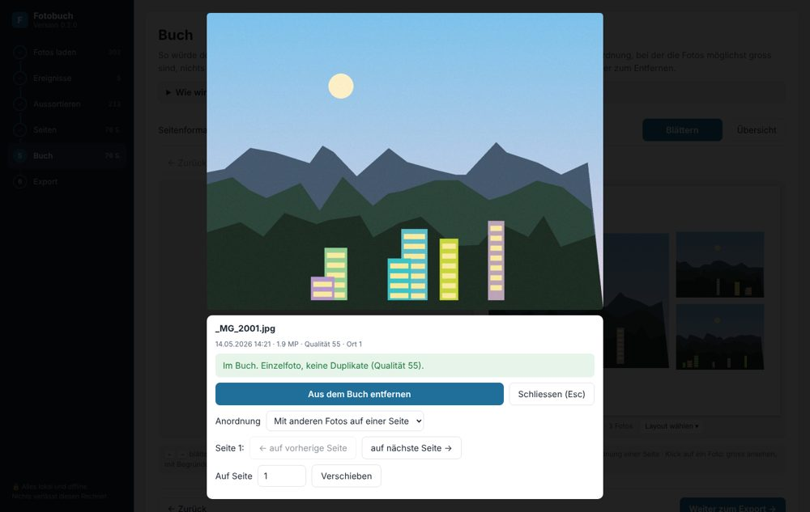

## Panorama über die Doppelseite

Neu: Sehr breite Fotos laufen über beide Seiten. Links Seite 40, rechts Seite 41, ohne Bruch in der Mitte.

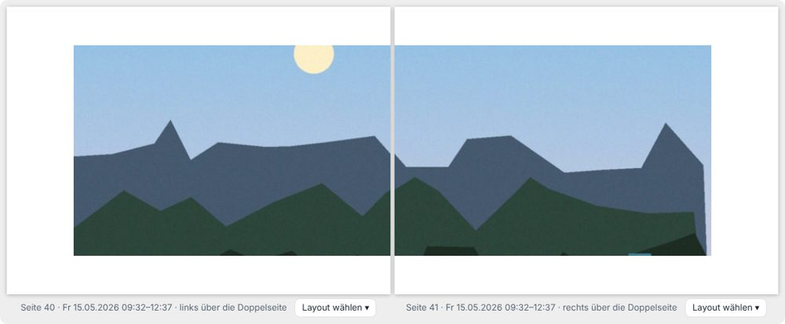

## Foto auf eine andere Seite legen

Neu: In der Detailansicht lässt sich ein Foto auf die vorherige oder nächste Seite oder auf eine gewählte Seitennummer legen. Dort steht auch die Seitenart (mit anderen Fotos, ganze Seite, über die Doppelseite).

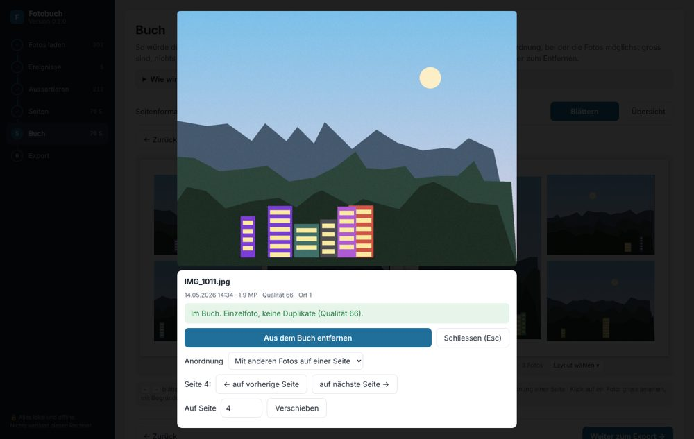

## Nach dem Verschieben

Die Seite davor hat ein Foto weniger, die Seite danach eines mehr. «Alle Verschiebungen zurücksetzen» erscheint unter dem Buch.

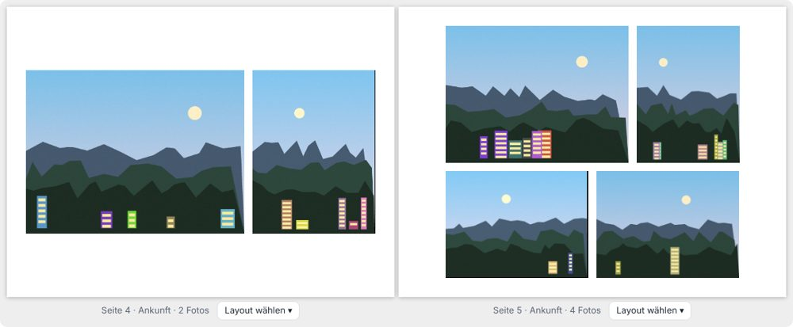

## Layout-Vorlagen

Pro Seite lassen sich Anordnungen wie Vorlagen wählen.

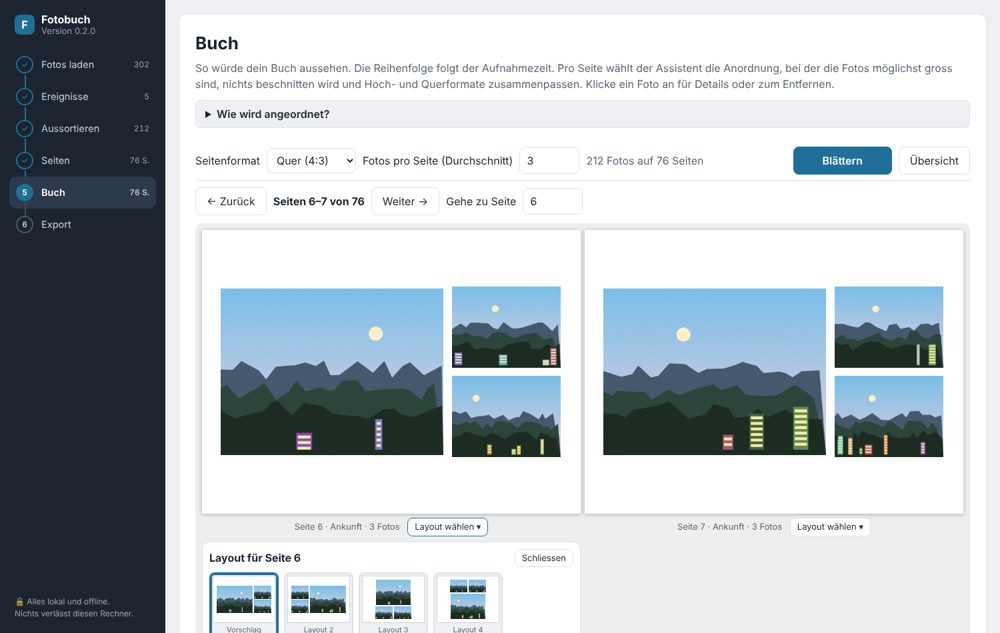

## Buch, Übersicht

Alle Seiten auf einen Blick.

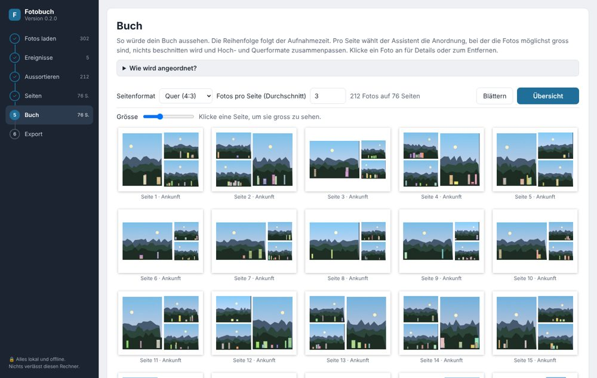

## Buch, Doppelseite

Blättern durch das Buch mit automatisch gewählten Layouts.

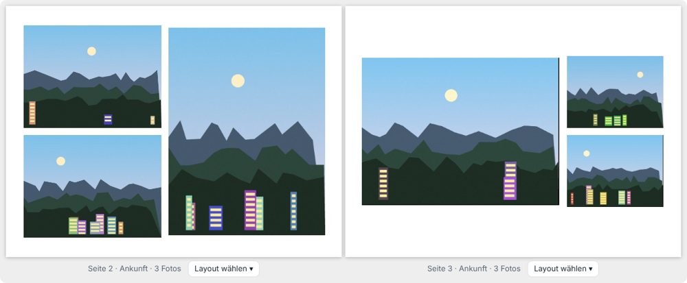

## Export mit fertigen Seiten

Jede Seite als JPEG (300 dpi) und alle Seiten als eine PDF.

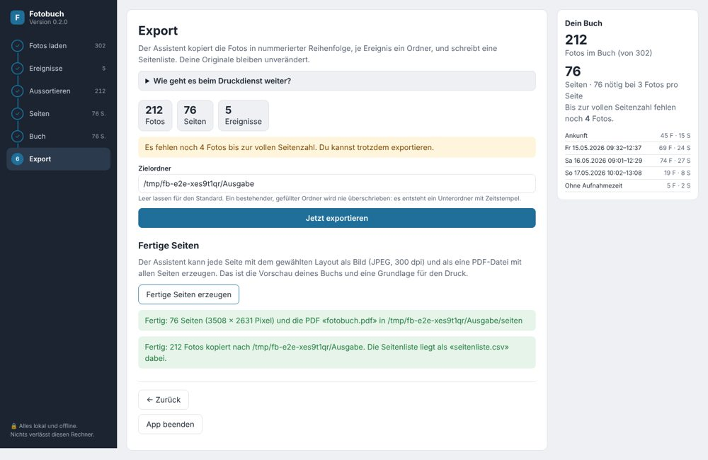

## Fertige Seite 1

Gerendert aus dem Export.

## Fertige Seite 2

Gerenderte Seite aus dem Export, verkleinert.

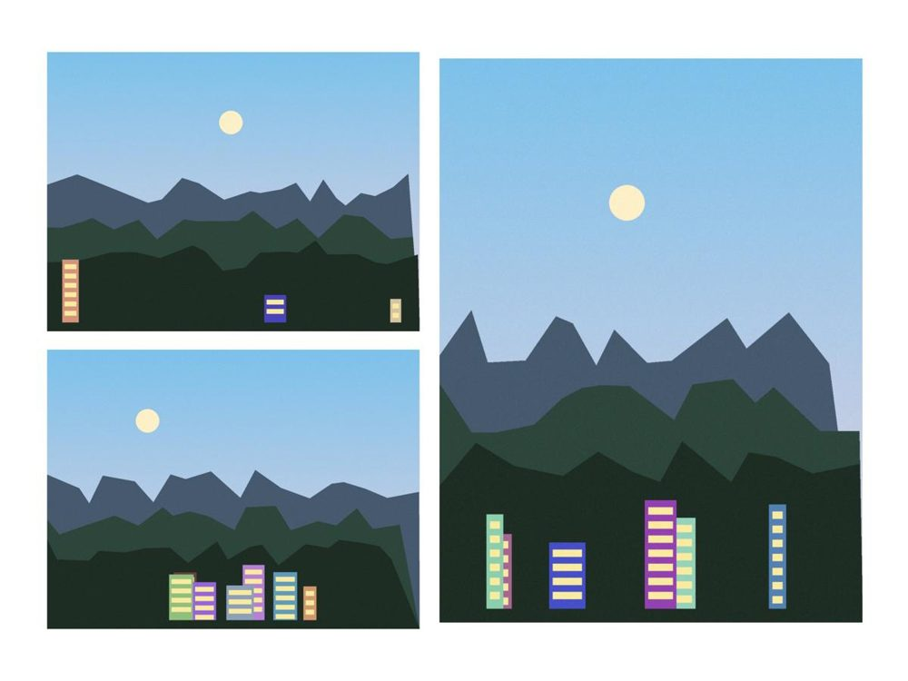
